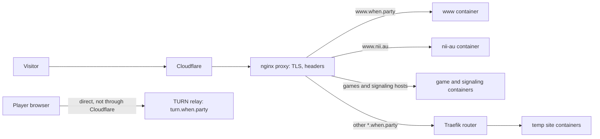

# WhenParty

Everything that runs on the WhenParty VPS: the When Party site at `www.when.party`, the site at `www.nii.au`, temporary sites and peer-to-peer browser games on `*.when.party`, and the nginx proxy in front of them all.

## How a request reaches a site

Every site sits behind Cloudflare. Cloudflare passes each request to the nginx proxy in [infra/](/infra/README.md), which terminates TLS, adds the security headers and hands the request to the right container. `when.party` and `nii.au` redirect to their `www` hosts. On `games.when.party`, the proxy finds a game title's container by its path, with the page that lists the games at its root, and it passes `signaling.when.party` to the signaling server. Every other `*.when.party` host goes to the Traefik router of [temp-sites/](/temp-sites/README.md), which finds the temporary site's container by its host name.

The games in [games/](/games/AGENTS.md) send game data directly between players' browsers. The signaling server at `signaling.when.party` helps the players find each other. When two browsers cannot connect directly, they relay through the TURN server, which players reach without Cloudflare or nginx.

## How changes reach the VPS

A push to `main` deploys only the parts whose files it changes. A change to Markdown files alone deploys nothing.

| Folder | Workflow | What it deploys |
| --- | --- | --- |
| `infra/` | `infra.yml` | the nginx proxy and its configs |
| `www/` | `www.yml` | the When Party site |
| `nii-au/` | `nii-au.yml` | the `www.nii.au` site |
| `temp-sites/projects/` | `temp-sites.yml` | each temporary site that changed |
| `temp-sites/traefik/` | `traefik.yml` | the Traefik router |
| `games/` | `games.yml` | each game, the signaling server and the TURN relay, when a change reaches them |

The [workflows](/.github/workflows/) live in `.github/workflows/`. Each site and game runs as a container from an image that the workflow builds and pushes to the GitHub Container Registry, and the VPS pulls it from there.

Before a deploy, `games.yml` runs the games' tests and `infra.yml` checks the nginx configs. Every pull request and every push to `main` also runs these checks for what it changes. It also checks that deployment names do not clash, that no other container takes a name the proxy uses for the games, and the length of every changed Markdown document. Once a week, every image the VPS runs is scanned for known vulnerabilities.
