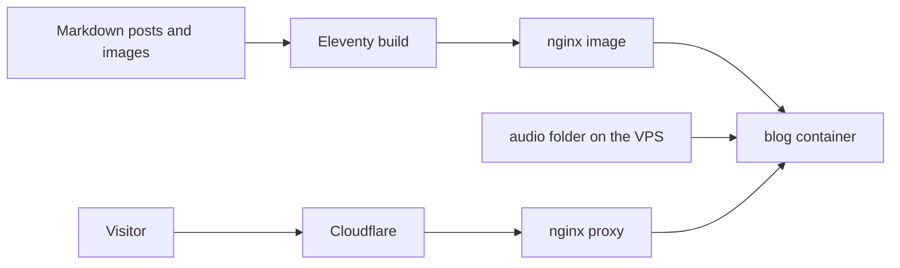

# When Party blog

The blog at [blog.when.party](https://blog.when.party): dated posts about what its author learns, starting with a course on communication and working with AI agents. Most posts have an audio version made with NotebookLM. A post keeps the views of its date, and later views go into new posts, as [posts.md](docs/posts.md) says, so the blog shows how they change.

A post is a Markdown file with its images beside it. Eleventy builds the posts into static pages in the style of the games' page at `games.when.party`, with sage in place of its denim, and an nginx container serves them, as [site.md](docs/site.md) says. The audio files are not in the repository: they lie in a [folder on the VPS](docs/audio.md) that the container reads.

The list of posts shows the newest first, as cards, with its picture when it has one. A post page shows its picture as a taped card beside the title, an audio player when the post has audio, and contents when it has more than three sections. Pictures inside a post are taped cards across the text or at its side.
