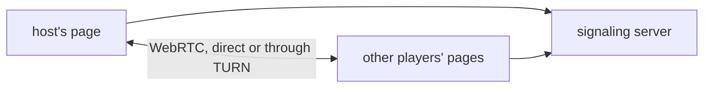

# Games

Browser games at [games.when.party](https://games.when.party) that people play together, each on their own device. The page at the root lists the games, and each game lives under a path of its own, such as `games.when.party/tictactoe/`. They include tic-tac-toe for two players and Calisthenics, a street workout championship.

One player's page creates a room, and the others join it with its code or an invite link. The page of the player who created the room is the host: it keeps the game's state and sends it to the other pages. The pages send game data to each other over WebRTC. The signaling server at `signaling.when.party` helps them find each other, and when two browsers cannot connect directly, they relay through the TURN server at `turn.when.party`, which players reach without Cloudflare or nginx.

The games play through a shared [platform](platform/README.md): rooms, seats and connections come from it, and each game keeps its own rules and results. Tic-tac-toe plays through the platform's layers transport, rooms and netcode, and Calisthenics through its p2p module. A change goes live when it reaches `main` and the games' tests pass.
