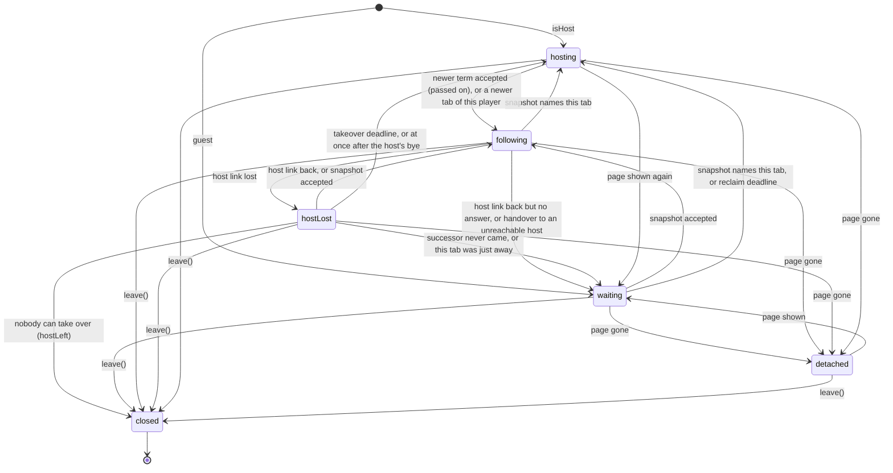

# Session States

What a session does, as a state machine. The machine is `src/session-machine.ts`: `step(model, event, env)` returns the next model and the effects to run, and never reads the clock or the network itself. `src/session.ts` runs it: it feeds it the room's and the page's events, sends what it says to send, joins and leaves the room, keeps a real timer for each deadline, and tells the page. `README.md` says *why* each rule exists; this file says *when* it applies.

## Shape

- **Model**: the phase, the page, what this tab knows of each peer, and the guest's pending intent. Each phase is a case of a tagged union, so data only one phase has (a deadline, the holds, the last room) exists only in it.
- **Events**: the room's (`peerJoined`, `peerLeft`, `unreachable`, `snapshot`, `intent`, `presence`, `bye`), the page's (`leaving`, `gone`, `shown`, `away`, `back`), the game's (`send`, `leave`), and `deadline`.
- **Env**: the time, the peers linked right now (`getPeers()`), and whether the signaling server is reachable.
- **Effects**: `send`, `rejoin` (leave the room and join it again), `detach` (leave it, hear nothing more), `close` (leave for good).
- **Timers are part of the state.** `timersOf(model)` lists every deadline the model waits for. After each event the driver sets a real timer for each one and clears every timer that is no longer listed. A state that is left takes its deadlines with it, so a timer can't outlive the state that set it, and one region can't clear another's. A `deadline` event is handled only if the model still waits for it and it is due.
- Events are handled one at a time, in order, even when one causes another. The page gets a view only when it changed.

## Regions

| Region | States | Deadlines |
| --- | --- | --- |
| **Phase**: this tab's role in the room | `waiting`, `following`, `hostLost`, `hosting`, `detached`, `closed` | at most one (`phase`) |
| **Page** | hidden or not, `backAt`, and `revive` after `beforeunload` | `revive` |
| **Peer**, per peer, every phase | `playerId`, `away`, `bye`, `lost`, `unreachable` | none |
| **Hold**, per member, `hosting` only | `held`, `settling` | `hold:<peer>` |
| **Pending intent**, guest | the last intent, until handled | none |

`T` below is `takeoverDelayMs` (2.5 s by default).

## Phase

Whenever the room state changes, the phase is worked out from it (`settle`): `hosting` if it names this tab as host, `hostLost` if this tab lost the host it names, `following` otherwise. A phase that stays keeps its own data.

### `waiting`: joined, no room state yet

- **Reclaim** (optional): `{at, lastRoom, asMember}`.
  - A host joining again (page shown, cancelled unload, handover to an unreachable host), a successor that was just away, or `rejoinAsHost`: at `+2T`, hosting `hostAlone(lastRoom)` as resumed, or a new fresh room without one.
  - A guest that was in the room (has `lastRoom`): at `+4T`, the game as it last saw it, but as a **fresh** room, so it gives way to any room that went on. If the signaling server is down or a peer is unreachable, it looks again `4T` later instead: the room may just be out of reach.
  - A tab that never was in the room: no reclaim. Its code may be wrong, and only the player can start the room.
- **Exits**: a snapshot that names its sender as host → `following`; one that names this tab → `hosting`; the reclaim deadline → `hosting`, with the linked peers added and the pending intent applied.

### `following`: a guest with a link to its host

- **confirmBy** (optional): set when the link to the host comes up again. A host answers every presence with the room, so if no snapshot arrives by `+2T`, the tab on that connection no longer hosts (it went into the cache and came back as a guest, say), and this tab joins again.
- **Exits**: the host's link drops → `hostLost`; an accepted snapshot (`acceptsSnapshot`) → stays, resending the pending intent if the host changed; a handover to a host this tab has no link to → `waiting`.

### `hostLost`: the host's link dropped (`switchingHost`)

Decided again on entry, on every link that drops or comes back, and at the deadline, from the last snapshot and the lost peers:

| Who is next (`successorOf`) | Waits | Then |
| --- | --- | --- |
| nobody | none | `closed`, `hostLeft` |
| another member | until `+4T`, kept while the same member is next | `waiting` (`joinAgain`): this tab's own links dropped |
| this tab, just away (hidden, or shown within `12T`) | none | `waiting`, reclaim as host: its snapshot may be old |
| this tab, the host said `bye` | none | `hosting` at once |
| this tab | until `+T`, kept while it stays next | `hosting` (`promote`, new term, lost members held) |

The host's link coming back → `following`.

### `hosting`: this tab runs the rules

- Commits (broadcasts) on every presence, game-changing intent, page `away`/`back`, member lost or dropped. Duplicate or rejected intents go to their sender only.
- An accepted snapshot (newer term) → passes it on to its guests and follows. Same term and `winsTie` → `term + 1`.
- A presence from this player's newer tab hands it the room: the committed room names that tab, so this tab follows it.
- Page shown again → `waiting`, reclaim as host.

### `detached`: the page went (`pagehide`)

- The room is left so the others hear at once. It keeps the room and whether to host again, for a page back from the back-forward cache.
- Owns no deadlines, ignores the left room's events, and publishes nothing: the page keeps the view it had. (A title reads `isHost` from it to host again after a reload.)
- Page shown → `waiting`, with the reclaim it would have had.

### `closed`: for good

Absorbing: `step` returns it unchanged for any event. `leave()` again returns the same promise. A session closed by `leave()` publishes nothing more; one closed with `hostLeft` tells the page.

## Page

- `away` / `back`: sets hidden (and `backAt` when shown again), sends a presence; a host also commits, so `absent` reaches everyone.
- `leaving` (`beforeunload`): `revive` at `+T`. Trystero already left the room, so a page still here then joins again. Only the page region clears it.
- `gone` (`pagehide`) → `detached`. `shown` (from the cache) → joins again.

## Peer

A link that comes up forgets the peer's player and `bye` until it says them again, and gets this tab's presence. A link that drops marks it `lost`. `unreachable` is set when the signaling server found it but no link came up, and cleared when it links. Everything is forgotten when the tab joins again.

## Hold (`hosting`)

| State | Entry | Deadline | Exits |
| --- | --- | --- | --- |
| `held` | a member's link drops; `since` kept if still settling | `since + awayHoldMs` if away (its presence or the last `absent`), else `since + 2T`; dropped at once after `bye` or if already past | deadline → drop (or move the player to its other tab); link back → `settling`; `bye` → drop |
| `settling` | link back | `+2T` | deadline → forgotten; link drops → `held`, same `since` |

`held` shows as `offline` in `absent`. Holds end with `hosting`.

## Pending Intent (guest)

Set by `send()`. Cleared by a snapshot with `handled[me] ≥ id`. Resent to a host this tab had not followed. Applied to the room when this tab starts hosting (takeover or reclaim).

## Invariants

Checked by `invariantViolations` after every event (the driver warns, the tests fail):

1. `hosting` ⇒ the room names this tab as host.
2. `following` ⇒ the host is another tab, and not lost.
3. `hostLost` ⇒ the host is another tab, and lost; a successor it waits for is not this tab.

Kept by construction:

4. Every deadline belongs to a state (`timersOf`); a state that is left takes it along.
5. `detached` and `closed` own no deadlines; `closed` is absorbing.
6. `isHost` ⇔ `hosting`, `switchingHost` ⇔ `hostLost`, `hostLeft` ⇒ `closed`.

Checked by the randomized test (`tests/session-fuzz.test.ts`): a tab's term never goes down between two joins, and once every link is back and every page shown, the tabs still in the room follow one host among them.

## Waits With No Deadline

- `waiting` for a tab that never was in the room: until a host speaks, or the player starts the room.
- `waiting` as a guest while the signaling server is down or a peer is unreachable: it looks again every `4T`.
- `following` a host that never answers but whose link never drops or comes back: as long as the link holds. WebRTC drops a dead link eventually.
