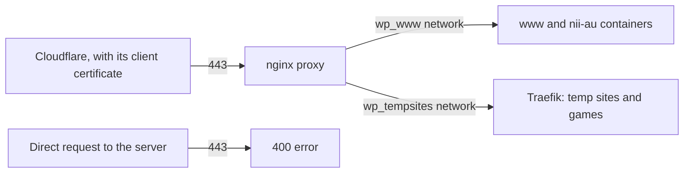

# nginx proxy

The nginx proxy that stands in front of every site on the WhenParty VPS. It is the only container that listens on the public ports 80 and 443.

On port 443 it terminates TLS with Cloudflare Origin Certificates for `when.party` and `nii.au`. It accepts a connection only when the client presents Cloudflare's client certificate. This is Cloudflare's Authenticated Origin Pulls, so a request sent straight to the server's address, around Cloudflare, gets an error. Port 80 redirects every request to HTTPS and answers a health check.

For every site the proxy sets the same security headers, rate limits each client address and passes WebSocket connections through. Each site adds its own Content-Security-Policy. Cloudflare sends the visitor's address in a header, and the proxy trusts that header only from Cloudflare's addresses. A job on the VPS refreshes the list of those addresses every hour.

A change to the configs goes live when it reaches `main`, after the configs pass `nginx -t`.
