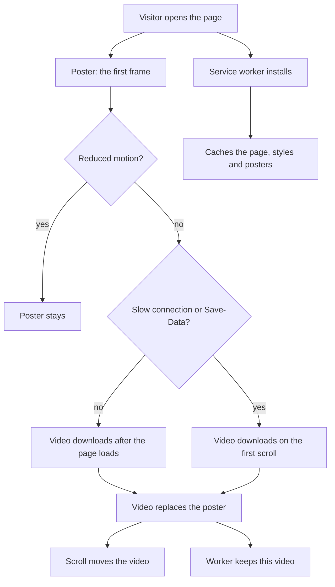

# nii.au site

The site at [www.nii.au](https://www.nii.au); `nii.au` redirects to it. It is "little by little.", a one-page site for a small creative club that offers one creative prompt each week.

The page opens with an illustrated journey through a pencil-and-watercolor coastal village. Scrolling moves a 10-second video forward and back, and a slider does the same. Portrait phones get a narrow slice of the frame that pans with the scroll. Browsers that decode AV1 in hardware get smaller AV1 files, and others get H.264.

The site can be installed as an app and works offline after a visit that loaded the video. Every deploy gives the changed media, styles and scripts new names, so browsers keep those files for a year and still get each change on the next visit.

An nginx container serves the site behind the nginx proxy in `infra/`, which adds TLS and the security headers. A change goes live when it reaches `main`.
