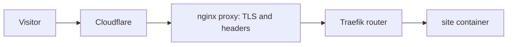

# Temp sites

Small sites that live for a while on their own host under `when.party`, such as `dtm-cleaning.when.party`. Each site is a folder in `projects/` with its own container. `dtm-cleaning` is a placeholder page.

Apart from the hosts with a site of their own, such as `www.when.party` and `games.when.party`, nginx hands every `*.when.party` host to one Traefik router, which `traefik/` holds. Traefik reads the labels of the running containers and sends the request to the container whose label names that host.

A new or changed site goes live when it reaches `main`, once its host and image are set up. Only the sites that a change touches are rebuilt. A site whose folder is deleted is taken down.
