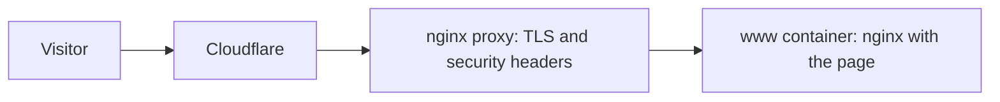

# When Party site

The site at [www.when.party](https://www.when.party); `when.party` redirects to it. It is one page with the name and a contact address.

It follows the Pencil & Gouache design system: graphite pencil lines on off-white paper, the Golos Text font, and color only on what matters, here a denim gouache band under the contact address. It follows the light or dark theme of the device.

A change to the page goes live when it reaches `main`.
