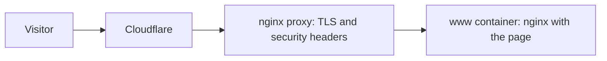

# When Party site

The site at [www.when.party](https://www.when.party); `when.party` redirects to it. It is one page: the name, a short introduction, a contact address, and balloons tied to a pencil rope: one opens the games at `games.when.party`, and a dashed one marked “soon” is not a link. A click on a balloon releases it: it flies up while the rest of the page fades, and then the site opens.

It follows the Pencil & Gouache design system: graphite pencil lines on off-white paper, the Golos Text font, and color only on the navigation, here the denim gouache of the games balloon. The contact address sits on a faint graphite band. It follows the light or dark theme of the device and shows no motion to visitors who ask for reduced motion.

Browser tests check the balloon takeoff and compare a storyboard of it with approved screenshots. A change to the page goes live when it reaches `main`, without waiting for the tests.
