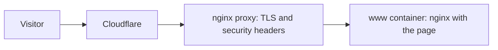

# When Party site

The site at [www.when.party](https://www.when.party); `when.party` [redirects](/infra/docs/specs/3-sites.md) to it. It is one page: the name, a short introduction, a contact address, and balloons tied to a pencil rope: one opens the games at `games.when.party`, one opens the blog at `blog.when.party`, and a dashed one marked “soon” is not a link. On wide screens the balloons are tied one under another along a rope with a weight at its end, in turn on its left and its right. On narrow screens they stand in a row over a horizontal rope, at alternating heights. A click on a balloon releases it: it flies up while the rest of the page fades, and then the site opens.

It follows the Pencil & Gouache design system: graphite pencil lines on off-white paper, the Golos Text font, and color only on the navigation, here the denim gouache of the games balloon and the sage of the blog balloon. The contact address sits on a faint graphite band. It follows the light or dark theme of the device and shows no motion to visitors who ask for reduced motion.

The nginx proxy terminates TLS (`1-1` of its [1-connections.md](/infra/docs/specs/1-connections.md)), sets the headers of its [2-headers.md](/infra/docs/specs/2-headers.md) and passes `www.when.party` to the container, as `3-1` of [3-sites.md](/infra/docs/specs/3-sites.md) says.

[Browser tests](docs/tests.md) check the balloon takeoff and compare a storyboard of it with approved screenshots. A change to the page reaches `main` after the tests pass on its [pull request](/.github/docs/github-setup.md#main-branch), and it [goes live](/.github/docs/deploys.md) without waiting for their run on `main`, as [checks.md](/.github/docs/checks.md) says.
